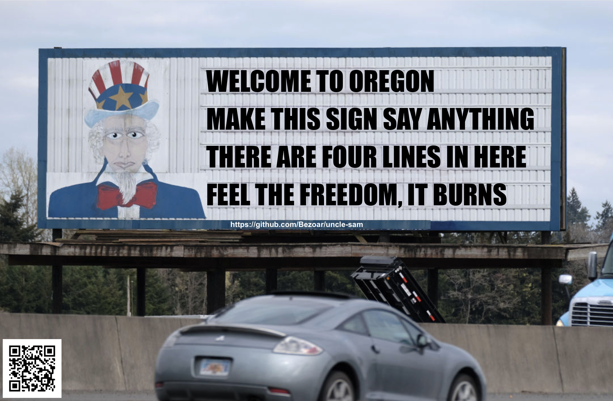

# uncle-sam

This is a meme generator that lets you put any message you want on a photo of [the Uncle Sam billboard](https://en.wikipedia.org/wiki/Uncle_Sam_billboard) as seen on a highway between Portland and Seattle.

I made this with Claude 4 Opus and Claude Code to learn how to work with those tools.

See CLAUDE.md for more information.